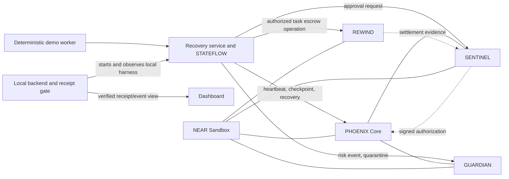

# NEAR PHOENIX v5.0

**A local-first recovery prototype for autonomous AI-agent tasks.** PHOENIX
demonstrates how a failed task worker can be replaced while contract-enforced
authorization, checkpoint validation, fencing epochs and escrow rules constrain
what the replacement can do.

This is a hackathon prototype, not a production custody system or audited
product. Tests and demonstrations use disposable **NEAR Sandbox** accounts and
funds only. No public deployment or real-fund transaction is part of the demo.

## The problem and the approach

An autonomous agent can stop midway through a paid task. Restarting it from
untrusted state risks lost work, stale execution, duplicate payments or an
unauthorized replacement. PHOENIX combines signed task checkpoints, on-chain
recovery generations and independent approval so a backup can resume within a
bounded policy. REWIND keeps task escrow subject to recipient, amount,
authorization and exactly-once operation checks.

NEAR is used for the parts that need shared, durable enforcement: contract
state, authorization boundaries, fencing generations, quarantine and escrow
state. Worker monitoring, checkpoint blobs, orchestration and the dashboard run
off-chain. A NEAR transaction or signed receipt establishes what the configured
contract accepted; it does not establish that an AI result is correct.

## Architecture



The sandbox integration test deploys the existing contracts into fresh local
accounts and exercises contract calls. The one-command terminal demo runs that
test through the backend's success gate and exports the observed run as JSON.
The interactive dashboard can start the same local harness. Dashboard contract
telemetry is a separate read-only RPC view and may show unavailable until local
contract IDs and RPC configuration are provided.

## Feature status

| Area | Status | Boundary |
| --- | --- | --- |
| PHOENIX Core recovery state and fencing | Implemented and tested | Rust contract; local Sandbox scenarios exercise authorized takeover and stale-epoch rejection. |
| SENTINEL approvals | Implemented and tested | Contract verifies scoped, expiring, one-time authorization; key custody is test-only. |
| GUARDIAN warnings, audit and quarantine | Implemented and tested | Contract-level containment; it does not isolate or terminate a host process. |
| STATEFLOW checkpoints | Implemented and tested | Signed and domain-bound checkpoint validation/restoration; demo worker is deterministic. |
| REWIND escrow | Implemented and tested in Sandbox | Native NEAR escrow, callbacks, duplicate protection and fail-closed uncertain outcomes. Lost-callback reconciliation is not implemented; uncertain funds remain locked. |
| Recovery service | Implemented and tested | Local coordinator and worker; no production chain adapter, distributed coordinator or live LLM runtime. |
| Proof-of-Recovery receipt | Implemented and tested | SENTINEL-signed receipt is recorded and backend-validated against demo evidence. This is not an independently verified NEAR light-client/receipt proof. |
| Backend | Implemented and tested | Loopback control API, local demo gate and persistent single-host replay ledger. No API authentication or distributed replay store. |
| Dashboard | Implemented; typechecked, tested and production-built | Existing UI is unchanged by release documentation work. Browser-based visual/E2E checks were unavailable in this environment. |
| Production adapters, key custody, host isolation, cryptographic NEAR proof verification | Future work | Not represented as production-ready or independently verified. |

The latest test run and its exact counts are in
[the Grand Prize release report](docs/GRAND-PRIZE-RELEASE-REPORT.md). Historical
phase reports are retained under `docs/`; their results apply to the revisions
and environments they identify.

## Requirements and installation

Use Ubuntu or WSL Ubuntu with:

- Rust stable, Cargo, and `wasm32-unknown-unknown`;
- `cargo-near` compatible with NEAR SDK 5.30.0;
- Node.js 22+ and npm;
- enough disk for Rust, Node, and disposable Sandbox build/runtime caches.

Install JS dependencies and build/test locally:

```sh
npm ci
cargo test --workspace --locked
cargo test --manifest-path services/recovery/Cargo.toml --locked
npm run typecheck
npm test -w @phoenix/backend
npm run test:wallet -w @phoenix/dashboard
npm run test:evidence -w @phoenix/dashboard
npm run test:transitions -w @phoenix/dashboard
bash scripts/build-near.sh
cargo test --manifest-path integration-tests/Cargo.toml --locked -- --nocapture --test-threads=1
npm run build -w @phoenix/dashboard
```

Run all available checks through the validation script:

```sh
bash scripts/test-phase6.sh
```

The script labels each stage and returns failure if any stage fails. The
integration suite uses only ephemeral local Sandbox deployments. It may need
network access the first time to download Rust dependencies or the Sandbox
binary, plus local socket permissions. It does not require a funded wallet,
public RPC, testnet or mainnet credentials.

## One-command local recovery demo

After installing dependencies, run:

```sh
npm run demo:local
```

This builds local contract artifacts and the recovery worker/backend, runs the
unified Phase 7B Sandbox scenario, checks the emitted receipt with the backend
success gate, and writes this run's JSON evidence to a unique file under `/tmp`
(or `$TMPDIR`). It does not start a browser or dashboard. The event sequence
includes primary heartbeat and checkpoint, primary failure, backup restoration
with a higher fencing epoch, one Sandbox escrow settlement, duplicate-payment
rejection, receipt validation, GUARDIAN warning/quarantine and completion. A
nonzero test result, missing required event or invalid/replayed receipt fails
the gate. Inspect the exact JSON path printed by the command; do not substitute
the historical checked-in evidence file for a fresh run.

The receipt's signature and bindings are checked by the application and the
scenario's contract assertions. The Phase 8B feasibility work did **not** verify
the complete NEAR cryptographic proof chain linking a finalized transaction and
receipt to the exact REWIND operation. RPC/harness-reported evidence remains
within the configured local Sandbox trust boundary. See the
[Phase 8B report](docs/PHASE8B-PROOF-FEASIBILITY-REPORT.md).

### Interactive dashboard

Start the API and dashboard in separate terminals:

```sh
NEAR_NETWORK=localnet npm run dev:api
npm run dev:dashboard
```

Open `http://localhost:3000` and use **Run local demonstration**. The API binds
to loopback. The dashboard's RPC telemetry panels require configured local
contract IDs and a local RPC URL; the isolated ephemeral demo may still run
without those panels. For the detailed environment variables and shutdown
behavior, see [installation](docs/installation.md).

## Security boundaries and known limitations

- Keep uncertain REWIND transfers locked. Lost-callback reconciliation is a
  design-only area; off-chain evidence cannot release funds.
- The backend checks signatures, replay state and event bindings. It does not
  independently validate NEAR light-client finality or execution proofs.
- Replay protection is durable on a single host, not a distributed consensus
  service. API loopback/CORS is not authentication against other local
  processes.
- The demo worker is deterministic, not an LLM. It proves a recovery flow, not
  agent reasoning quality or real-world task correctness.
- GUARDIAN quarantine is contract-scoped and cannot isolate a compromised host
  or worker.
- Production key custody, production chain/verifier adapters, operational
  migration, distributed coordination, service authentication and independent
  security audit are absent.
- The optional operator workbench supports only `heartbeat` and
  `report_crash`. It is disabled unless the backend operator explicitly sets
  `PHOENIX_ENABLE_WALLET_ACTIONS=true`; mainnet additionally requires
  `PHOENIX_ENABLE_MAINNET_ACTIONS=reviewed`. A connected wallet does not submit
  an action. Any enabled action still requires a fresh review and explicit
  approval in the user's wallet. This is not a read-only wallet workflow when
  those operator flags are enabled. The workbench cannot settle escrow, move
  funds, deploy contracts, or authorize recovery.
- No browser-driven hydration/console verification or recording was available
  during this release pass.

Do not claim production readiness, independent cryptographic proof verification,
or real-world recovery metrics from these tests. See the
[Phase 8 security report](docs/PHASE8-SECURITY-REPORT.md) and
[security limitations](docs/security-limitations.md).

## Evidence and release materials

- [Phase 7 integration and Phase 7B evidence](docs/PHASE7-INTEGRATION-REPORT.md)
- [Phase 7B run evidence snapshot](docs/PHASE7B-E2E-EVIDENCE.json) — historical
  local Sandbox run; generate fresh evidence with `npm run demo:local`.
- [Phase 8 security review](docs/PHASE8-SECURITY-REPORT.md)
- [REWIND reconciliation design](docs/PHASE8-REWIND-RECONCILIATION-DESIGN.md)
- [Phase 8B proof feasibility](docs/PHASE8B-PROOF-FEASIBILITY-REPORT.md)
- [Architecture and test provenance](docs/architecture.md) and
  [test evidence](docs/test-evidence.md)
- [Two-minute demo narration and recording plan](docs/demo-script.md)
- [Grand Prize release gate and submission materials](docs/GRAND-PRIZE-RELEASE-REPORT.md)

Recommended hackathon tracks: **AI Security & Defense** (primary) and
**Agent Economy** (secondary). Track eligibility and form requirements should
be confirmed against the [official hackathon rules](https://nearhackathon.com/HACKATHON.md).

## Publication status

The repository has not been published and no application has been submitted.
The working tree contains uncommitted implementation and documentation. Review
the exact [release staging list](docs/release-stage-paths.txt) before creating
a public snapshot. The included MIT `LICENSE` applies only to original PHOENIX
software for which the project contributors hold rights. Third-party
dependencies, supplied design artwork and trademarks remain under their
respective terms; the project owner must confirm authority to distribute the
12 dashboard images before publishing them. No rights to third-party materials
are granted by this project's license.

The current [NEAR Hackathon page](https://nearhackathon.com/) requires a public
repository, a public X demo post with video or screenshots, and a form with both
links. It lists a deadline of 2026-11-14 23:59 UTC. The downloadable
`HACKATHON.md` could not be retrieved by this review tool, so confirm any extra
rules before submission. See [the Windows Chrome QA checklist](docs/browser-qa-windows.md),
[the two-minute demo script](docs/demo-script.md), and [the submission checklist](docs/submission-checklist.md).
