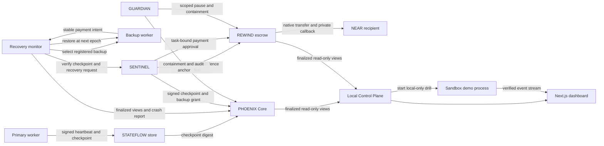

# Architecture

PHOENIX separates agent lifecycle and recovery, independent authorization,
escrow accounting and observation. The off-chain coordinator orchestrates work;
contracts independently enforce recovery and payment boundaries.

## Trust and control boundaries

### PHOENIX Core and STATEFLOW

PHOENIX Core records an agent's operator, independent sentinel, heartbeat
deadline, status and recovery generation. Heartbeat freshness uses NEAR block
time. A recovery grant is bound to the current generation, anchored checkpoint
digest and selected registered backup. Consuming the grant changes the worker
identity and advances the generation. Containment invalidates outstanding
recovery approval; reopening containment returns an agent to a crashed/verification
state and is owner-only.

STATEFLOW signatures and checkpoint blobs are verified off chain by the
coordinator and SENTINEL. Core anchors checkpoint identity/order but does not
itself validate the worker's Ed25519 checkpoint signature or model correctness.
The local content-addressed store uses bounded blobs, atomic publication and
filesystem permissions. Its lease is single-host coordination, not consensus.

### SENTINEL and GUARDIAN

SENTINEL is a distinct signer from the requesting worker/coordinator. Its short-
lived signed approval specifies the action, domain, task, requester, worker key,
generation, security revision, checkpoint, operation ID, recipient, amount,
commitment and nonce. Core/REWIND verify signatures and consume nonces on chain.
Recovery also requires the appropriate NEAR account authorization. Payment cannot
be authorized by a risk score.

GUARDIAN evaluates signed, source-authenticated events against configured rules.
It can stop scoped activity and anchor signed audit-chain heads. Quarantine
increments revisions and invalidates stale approvals. A GUARDIAN risk assessment
can trigger a stop; it cannot release a pause or authorize a transfer. The local
audit file requires protected persistent storage in any production design.

### REWIND escrow

Each task binds a depositor, executor, verifier, allowed recipients, amount limits,
expiration and attached principal. Storage bonds are accounted for separately.
Fenced tasks require the current execution epoch and the independent signed
approval path. Operation IDs are one-time tombstones. Native transfers are
asynchronous: only the contract's private callback can finalize the result.
Refunds cannot race unresolved operations. An uncertain transfer stays locked
until a verified callback/reconciliation proves an outcome. Safe mode blocks new
spending while preserving authorized refunds and callback handling.

Cross-contract state transitions are not atomic. The recovery flow fences REWIND
before granting PHOENIX recovery. Partial failure therefore blocks spending and
requires reconciliation rather than allowing two active payment epochs.

### Stage A: Proof-of-Recovery

Core stores an immutable recovery-transition row keyed by agent and destination
epoch. SENTINEL can attach a single domain-separated signature binding the
checkpoint, identities, epoch transition and security revision to a unique
successful REWIND operation and supplied finalized evidence. The SENTINEL
signing API checks the evidence against the pinned effect; its host must source
that evidence from a trusted finalized-state observer. Core checks its own
transition and the configured SENTINEL key, freshness and nonce; it cannot
synchronously query REWIND. Public readers can fetch the row with
`get_recovery_receipt`, then verify the signature and retained evidence using
the recovery service verification helpers. See
[Stage A details](phase-a-proof-of-recovery.md).

## Control Plane and dashboard

The backend binds to `127.0.0.1`, accepts only HTTP on loopback for its RPC
reader, and allows browser CORS only from `http://localhost:3000`. Demo-start is
a local POST action. There are no HTTP routes for settlement, refund, withdrawal,
recovery or quarantine release. Same-machine processes can still call loopback;
the origin check is a browser boundary, not local user authentication.

Telemetry is read from configured contract IDs using finalized local RPC state.
RPC results are reported as unavailable on errors; the UI does not infer success.
The demo button launches an isolated Rust harness using fresh ephemeral sandbox
accounts and forwards its structured events. It does not substitute demo data for
the dashboard's configured RPC telemetry. Completion requires all expected
events and a successful process exit. Backend restart marks an active demo
interrupted and terminates its process group.

## Demonstration path

The unified Phase 7B demo runs through `npm run demo:local`. It builds the
optimized contract artifacts and recovery worker, starts the backend-gated
integration harness, and saves a fresh event/receipt JSON file under `/tmp` (or
`$TMPDIR`). The disposable Sandbox scenario covers primary heartbeat and
checkpoint, failure, authorized backup restoration at the next epoch, one
REWIND settlement, duplicate-payment rejection, receipt verification and
GUARDIAN quarantine. The command fails if required events, the successful child
exit or receipt verification are missing. See the [two-minute demo script](demo-script.md).

The receipt signature and its bindings are validated against scenario evidence
inside the application and Sandbox harness. This is not an independently
verified NEAR light-client or execution proof; see the [Phase 8B report](PHASE8B-PROOF-FEASIBILITY-REPORT.md).

## Stage F: economics and data methodology

The on-chain denomination is native NEAR: callers attach task escrow plus the
contract's separate storage bond, while NEAR transaction execution consumes
network gas. The UI displays the configured task's raw yoctoNEAR accounting; it
does not estimate fiat value or imply protocol income. No PHOENIX token, fee,
emission or reward schedule exists in this implementation. An optional future
design could pay a backup operator through an explicitly budgeted, independently
approved REWIND operation after restoration evidence is verified. A recovery
receipt alone does not create a payment right. Any fee or incentive proposal
would need disclosed terms, governance, enforceable caps, opt-in task terms and
review of sustainability and Sybil/incentive risks.

Dashboard analytics use bounded sources. Failure-to-restoration latency is a
timestamp delta from the current local sandbox run. Duplicate-prevention counts
are observed event records from that same run. Authorization-failure and
incident counts are limited to the signed GUARDIAN audit records returned after
their bytes match the configured on-chain head. No complete recovery-attempt
history is available, so recovery success rate is reported unavailable. These
counts are not global or predictive; local sandbox events are not mainnet
transactions. The dashboard's finalized RPC observations also depend on the
configured RPC and are not independent cryptographic proofs.

The methodology follows the evidence path: observe heartbeat and inject a
controlled primary crash; verify signed checkpoint domain, signer, sequence and
digest; select from authorized backups under deterministic lease/fencing rules;
require fresh independent SENTINEL authorization and enforce GUARDIAN's scoped
quarantine; settle through REWIND's recipient/budget/epoch/unique-ID checks and
asynchronous callback; then verify receipt fields against Core state and trusted
observer-supplied settlement evidence. Each layer has separate authority: an
off-chain detector or risk score cannot authorize recovery or transfer.

Reproduction commands and current environment-specific results are maintained
in [test evidence](test-evidence.md); the hackathon [submission checklist](submission-checklist.md)
tracks remaining capture and judging requirements.

## Artifacts and protocol

`bash scripts/build-near.sh` generates the optimized artifacts consumed by the
integration loader under `target/near/`. `scripts/inspect-near-wasm.mjs` verifies
the import/export allowlist and writes `artifacts/near-wasm-manifest.json`.
Artifact parsing/import review is not runtime proof or reproducible-build
attestation. NEAR SDK 5.30.0 declares minimum protocol 88; the cached local
sandbox has previously reported nearcore 2.13.4 / protocol 86. The current
contracts use the reviewed host import subset, but do not claim that every SDK
5.30 feature is compatible with protocol 86. Runtime compatibility must be
retested against the exact sandbox/validator release used for judging.

See [security limitations](security-limitations.md), [installation](installation.md),
and [current test evidence](test-evidence.md).
